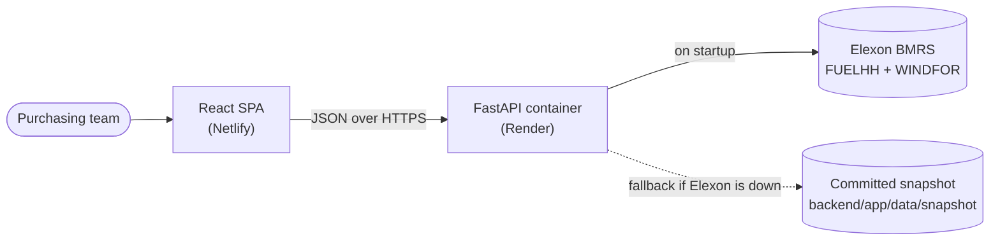

# GB Wind Forecast Monitor

A web app for a UK utility's day-ahead power purchasing team. It answers two questions for every
purchase decision made in **January 2026**:

1. **What wind did the latest forecast promise when we had to buy?** For each delivery day it shows
   the national wind forecast as it stood at the day-ahead decision time (11:00 UK on the day before),
   with a likely range (P10 to P90).
2. **How far can that forecast be trusted?** It measures the forecast against what was actually
   generated, at any lead time, and turns that into risk numbers a trader can use.

Data: Elexon BMRS only: national wind actuals (`FUELHH`, fuel type `WIND`) and wind forecasts (`WINDFOR`).

## Live links
- **App:** https://i5ks8r.netlify.app
- **API docs (Swagger):** https://i5ks8r-api.onrender.com/docs
- **Repository:** https://github.com/animesh9893/i5ks8r

The API runs on Render's free plan, which sleeps after 15 minutes without traffic. The first request
after a sleep takes about a minute while the container starts and loads data; the app shows a loading
state meanwhile.

> **Hosting note:** the brief suggests Vercel or Heroku. The frontend is on **Netlify** (a static
> host comparable to Vercel) and the Dockerised API is on **Render** (a container host comparable to
> Heroku). Moving either one only needs that platform's project settings; nothing in the code is
> host-specific apart from `netlify.toml`.

## What the app shows

| Page | Question it answers | Key content |
|---|---|---|
| **Day-Ahead Planner** | What did we know when we bought delivery day D? | The last forecast run published before D−1 11:00 UK, cut to day D. A P10–P90 range, KPIs (expected energy, "firm" P10 energy, peak/lowest hour, largest hourly swing), the actual outcome after the fact, an hourly table and CSV export. |
| **Forecast vs Actual** | How did forecasts made *h* hours ahead compare with reality? | Actual (30 min) against the latest forecast published at least *h* h before each hour (0–48 h), with zoom, hourly error bars (red = too high, blue = too low), KPIs and CSV export. |
| **Accuracy** | How big and how systematic is the error? | MAE, RMSE, bias, P90 error, error vs lead time (with the day-ahead lead times shaded), error by hour of day, error distribution, and a plain-English summary. |

Filters (date range, lead time or "day-ahead" mode, delivery day) live in the URL, so any view can be shared.

## Architecture



- **No database.** January 2026 is historical: about 1.6k actual rows and 16k forecast rows. The API
  fetches both datasets once at startup (in parallel, with retries) into in-memory pandas frames.
  Every query is a millisecond-scale pandas operation, and results are cached until the next reload.
- **Resilience.** If Elexon is unreachable, the API loads the committed snapshot and the UI badge
  says "Offline snapshot". `/api/health` answers immediately while data loads, and data endpoints
  return `503` until then.
- **Backend layering.** `clients/` (Elexon HTTP) → `data/` (normalisation and the store) →
  `services/` (pure functions: forecast selection, metrics) → `api/` (validation, caching, response
  schemas). The services hold all the domain logic and are unit-tested in isolation.
- **Frontend.** TanStack Query for fetching and caching (the previous chart stays visible while new
  filters load), Recharts for charts, Tailwind for styling. `src/api/types.ts` mirrors the backend's
  Pydantic schemas field for field.

### API

| Endpoint | Purpose |
|---|---|
| `GET /api/health` | liveness, plus whether data is loaded |
| `GET /api/meta` | data coverage, source (live/snapshot), delivery-day range |
| `GET /api/series?start&end&horizon_hours` | actual vs latest forecast at that lead time, hourly |
| `GET /api/day-ahead?delivery_date[&gate_local][&leakage_free]` | forecast at the D−1 decision time with P10/P50/P90 and day KPIs |
| `GET /api/metrics?start&end[&horizon_hours]` | headline accuracy (omit the horizon for day-ahead mode) |
| `GET /api/metrics/by-horizon`, `/by-hour`, `/distribution` | breakdowns for the Accuracy page |
| `POST /api/admin/refresh` | reload from Elexon (needs `X-Admin-Token`; disabled unless `ADMIN_TOKEN` is set) |

Full contract with examples: [`docs/plan/04-api-contract.md`](docs/plan/04-api-contract.md), or the live Swagger UI.

## Method

### Which forecast was "available"?
For a target hour *t* and lead time *h*, the app uses the **most recent forecast published at or
before *t − h*** (`pandas.merge_asof`, matched per target hour). It also reports the real lead time
of the forecast it used, which is always ≥ *h*. If nothing was published that early (for example
48 h ahead of 1 Jan), the value is left empty rather than guessed.

### Day-ahead decisions
For delivery day *D* (a UK-local day), the decision time is **11:00 UK on D−1**, matching the GB
day-ahead auctions; it can be changed per request. The app takes the **single forecast run**
published last before that time and cuts it to day D. In January this is the 09:30 UTC run, giving
lead times of 14.5 h to 37.5 h. "Decisions made in January 2026" means delivery days **2 Jan to 1 Feb**.

### Likely range (P10–P90)
Every past (forecast, actual) pair is grouped into 6-hour lead-time buckets. Within each bucket the
app takes the 10th, 50th and 90th percentiles of `actual − forecast`, and adds them to the forecast
for each hour of day D. **P10 is "firm wind"**: historically, actual wind reached at least this level
in about 9 of 10 hours. By default the percentiles use all of January, so they are in-sample. The
**strict out-of-sample** option (`leakage_free=true`) uses only errors already known at the decision time.

### Metrics
`error = forecast − actual` (MW). Positive means less wind arrived than was forecast, so the shortfall
had to be bought later, usually at a higher price.

| Metric | Definition |
|---|---|
| MAE | mean of \|error\|: the typical miss |
| RMSE | √mean(error²): penalises large misses |
| Bias | mean of error: the systematic tilt |
| nMAE | MAE / mean actual |
| MAPE | mean of \|error\| / actual, **excluding hours with actual < 500 MW** (it blows up near zero) |
| P50 / P90 / P99 abs error | percentiles of \|error\|; P90 = "90 % of hours were within ±X", a sensible risk buffer |
| Coverage | share of target hours that had a forecast at that lead time |

### Assumptions
- **Resolution.** Forecasts are hourly and actuals half-hourly. Each hourly forecast is compared with
  the half-hour actual starting at the same instant, with no averaging.
- **Forecast rows dated before their own publish time** (each WINDFOR run includes some) are dropped,
  because they are not forecasts.
- **Revised actuals.** If an actual is republished, the latest version is kept.
- **Time.** All data is in UTC. UK local time (which equals GMT in January) is used only for delivery-day
  boundaries, the decision time and display; the code handles summer time correctly.
- **Scope.** National wind only, per the brief. There is no demand or solar data, so the app reports
  wind risk rather than total purchase volume.

## Findings for January 2026

Day-ahead decisions (744 delivery hours, 2 Jan to 1 Feb):

| | 1 h ahead | 24 h ahead | 36 h ahead | **Day-ahead (D−1 11:00)** |
|---|---|---|---|---|
| MAE | 1.80 GW | 2.05 GW | 2.26 GW | **2.00 GW** (17.7 % of mean output) |
| Bias (forecast − actual) | +1.60 GW | +1.85 GW | +1.95 GW | **+1.73 GW** |
| 90 % of hours within | ±3.8 GW | ±4.1 GW | ±4.3 GW | **±4.2 GW** |

- **The forecast is consistently too high.** It exceeded the actual in 84 % of day-ahead hours, by
  about 1.7 GW on average, and the gap barely shrinks closer to delivery. About 48 % of the squared
  error is this constant offset, so **correcting for the bias before trading is the biggest single
  improvement available**. A likely cause (not verified) is that WINDFOR forecasts unconstrained
  output, while FUELHH records metered output after wind farms were curtailed.
- **Accuracy improves closer to delivery:** MAE falls from 2.4 GW at 48 h to 1.8 GW at 1 h, which
  supports re-trading intraday.
- **The P10–P90 range held** in 79 % of day-ahead hours (target 80 %, in-sample).
- **Worst delivery days:** 28 Jan (5.3 GW average miss; the actual was below P10 all day), then 11, 12,
  21 and 27 Jan. 15 Jan is a contrasting good day (1.1 GW miss, actual inside the range for all 24 hours).

## Repository layout

| Path | What it is |
|---|---|
| `backend/` | Python FastAPI service, deployed to Render from `backend/Dockerfile` |
| `backend/app/main.py`, `config.py` | app factory (CORS, gzip, request logging, background data load) and env settings |
| `backend/app/api/` | routers (`routes_meta`, `routes_series`, `routes_metrics`), request validation (`deps`), cached query composition (`queries`) |
| `backend/app/clients/elexon.py` | async Elexon client with retries |
| `backend/app/data/store.py`, `data/snapshot/` | in-memory data store and the committed offline snapshot |
| `backend/app/services/` | `forecast_selection.py` (which forecast was available) and `metrics.py` (accuracy, bands, KPIs) |
| `backend/app/schemas.py` | Pydantic response models: the API contract |
| `backend/scripts/fetch_snapshot.py` | refreshes the snapshot from Elexon (`python -m scripts.fetch_snapshot`) |
| `backend/tests/` | pytest suite: services on hand-built data, store/client, API contract against the snapshot |
| `backend/requirements*.txt`, `pyproject.toml` | pinned dependencies; ruff and pytest config |
| `frontend/` | React + TypeScript (Vite) single-page app, deployed to Netlify |
| `frontend/src/api/` | fetch client, TypeScript mirror of the API schemas, TanStack Query hooks |
| `frontend/src/pages/` | Day-Ahead Planner, Forecast vs Actual, Accuracy |
| `frontend/src/components/` | `charts/` (Recharts), `layout/` (header, tabs, filter bar, data gate), `ui/` (cards, KPI tiles, states) |
| `frontend/src/state/filters.ts` | URL-synced filters |
| `frontend/src/lib/` | formatting and UK-time helpers, CSV export, validated chart colours |
| `frontend/Dockerfile`, `frontend/nginx.conf` | static build served by nginx (local / compose only) |
| `docker-compose.yml` | runs API + web locally |
| `netlify.toml` | Netlify build config (base dir, API URL, SPA routing) |
| `.github/workflows/ci.yml` | CI: ruff, pytest, Docker build; ESLint, typecheck, build |
| `.env.example` | every environment variable, with defaults |
| `PLAN.md`, `docs/plan/` | design and implementation plan written before coding, updated as built |

## Running locally

### With Docker (recommended)
```bash
docker compose up --build
```
- Web: http://localhost:5173
- API: http://localhost:8000/api/health · docs at http://localhost:8000/docs

If ports 8000/5173 are busy, override them: `API_PORT=8001 WEB_PORT=5174 docker compose up --build`.
Set `DATA_SOURCE=snapshot` to run fully offline.

### Without Docker
Backend (Python 3.12):
```bash
cd backend
python -m venv .venv && source .venv/bin/activate
pip install -r requirements-dev.txt
uvicorn app.main:app --reload
```
Frontend (Node 20):
```bash
cd frontend
npm install
npm run dev
```
The frontend calls `http://localhost:8000` by default; set `VITE_API_BASE_URL` to point it elsewhere.

### Tests and checks
```bash
cd backend && ruff check . && pytest --cov=app
cd frontend && npm run lint && npm run typecheck && npm run build
```
The backend has 75 tests (99 % line coverage). The forecast-selection and metrics logic is tested
on small hand-built datasets with known answers, plus sanity checks on the real January snapshot.
CI runs all of the above on every push.

## Deployment
Push to `main` → GitHub Actions CI → Render rebuilds the API container and Netlify rebuilds the SPA.
Details: [`docs/plan/07-deployment.md`](docs/plan/07-deployment.md).

## Configuration
All environment variables are documented in [`.env.example`](.env.example).

## Limitations and next steps
- Add demand and solar forecasts to get **residual demand**, the volume actually bought.
- Fit the likely range on a rolling window of past data only (the strict option already exists per
  day), and add an automatic bias correction.
- Scheduled data ingestion into a database for live operation beyond January 2026.
- Frontend component tests (the UI is currently verified manually in the browser).

## AI tools used
This project was planned and implemented with help from **Claude Code** (Anthropic): planning,
code generation, tests and documentation. All code was reviewed, run and tested by the author.
